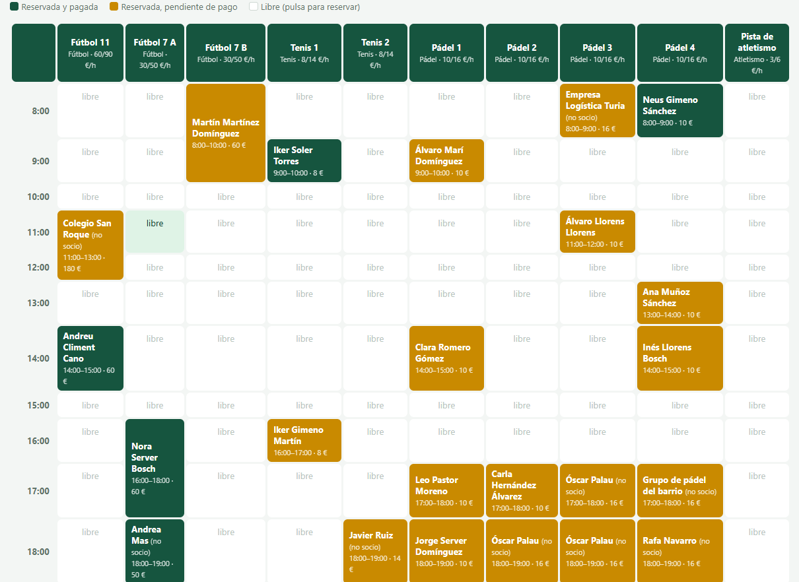
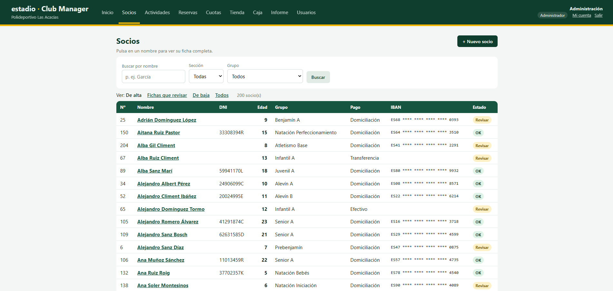
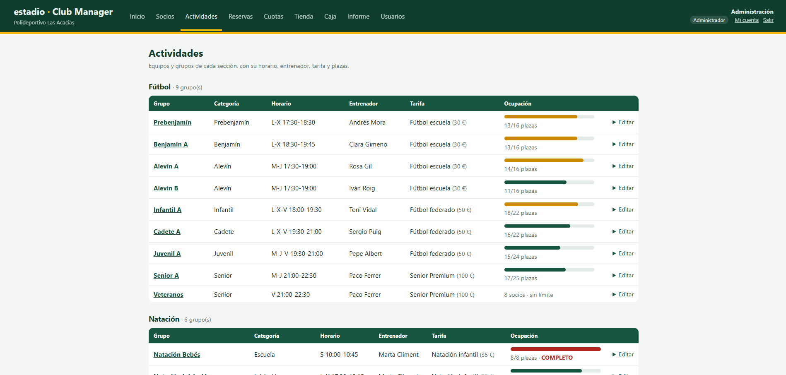
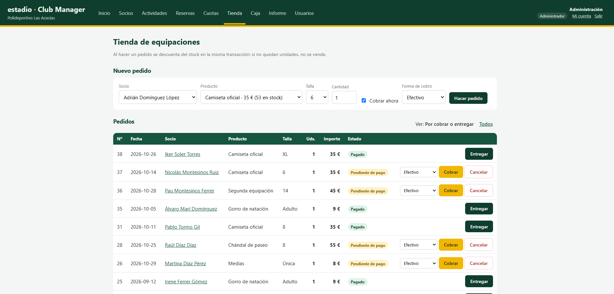
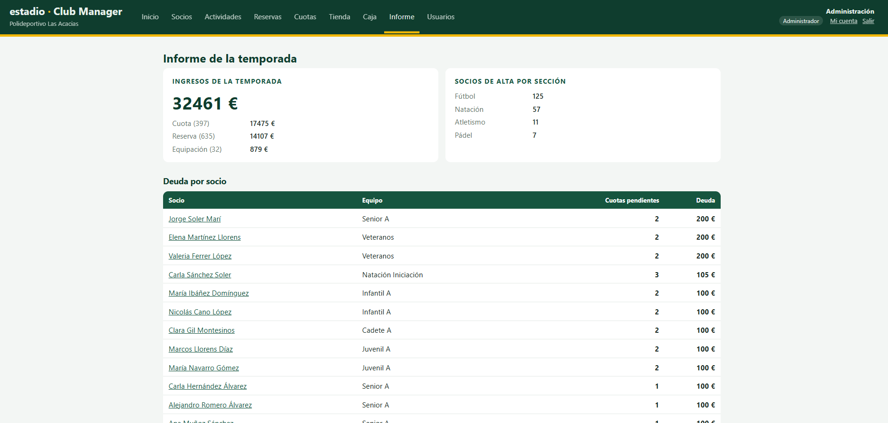
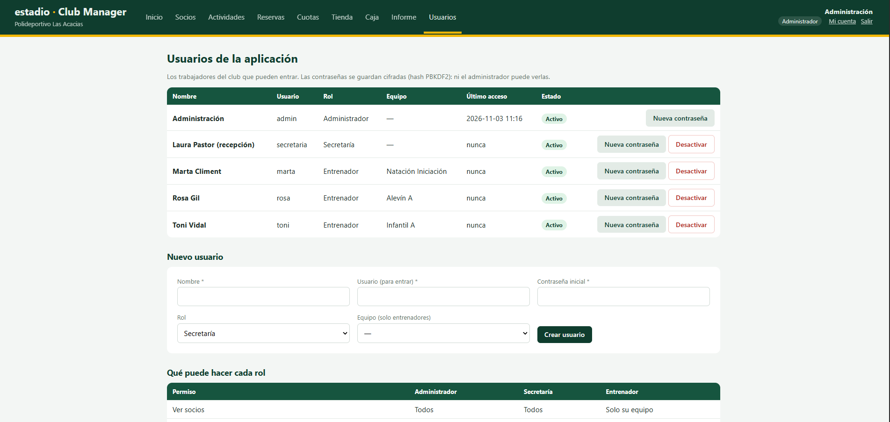

# estadio · Club Manager

**Software de gestión para clubes deportivos, hecho de arriba abajo:** una base de datos relacional propia en C++ (**diegofo | estadio**), un ORM propio en Python (**estadio_orm**) y la aplicación web que usan los trabajadores del club.

> RA3 · Acceso a datos (0486) — Diego Fernández Ortega · 2º DAM · Tame Formación



---

## Criterios del RA3: dónde está cada uno

| Criterio | Dónde | Demostración |
|---|---|---|
| a) Instalar la herramienta ORM | `pyproject.toml` → `pip install -e .` | [a)](#a-instalación-de-la-herramienta-orm) · `app_club.py` bloque 1 |
| b) Configurarla | `estadio.ini`, `estadio_orm/configuracion.py` | [b)](#b-configuración-de-la-herramienta-orm) · bloque 2 |
| c) Configuraciones de mapeo | `modelos.py` (10 clases), `estadio_orm/modelo.py` (metaclase) | [c)](#c-configuraciones-de-mapeo) · bloque 3 |
| d) Persistencia de objetos | `estadio_orm/sesion.py`: `agregar()` y `confirmar()` | [d)](#d-mecanismos-de-persistencia) · bloque 4 |
| e) Modificar y recuperar objetos | `obtener()`, atributos, `borrar()`, relaciones | [e)](#e-aplicaciones-que-modifican-y-recuperan-objetos-persistentes) · bloque 5 |
| f) Consultas con SQL | `Consulta`, `sesion.sql()`, `sql_objetos()` | [f)](#f-consultas-con-sql) · bloque 6 |
| g) Transacciones | `confirmar()`, `with sesion.transaccion()` | [g)](#g-transacciones) · bloque 7 |

> **Para corregir rápido:** `python app_club.py` recorre los criterios a–g en orden y enseña el SQL que genera el ORM. La aplicación web (`python web_club.py --reiniciar`) es la **aplicación real** que usa todo eso.

---

## El producto

| | |
|---|---|
| **Motor** | `estadio.exe`: un solo ejecutable de C++, sin instalar servidor ni dependencias. Las tablas se guardan en ficheros de texto legibles. |
| **SQL** | `CREATE TABLE` con `PRIMARY KEY` y `REFERENCES`, `INSERT`, `SELECT` con `JOIN`, `WHERE`, `LIKE`, `GROUP BY`, `COUNT`, `SUM`, `ORDER BY` y `LIMIT`, `UPDATE`, `DELETE`, transacciones y procedimientos almacenados. |
| **Integridad** | Claves primarias que se numeran solas, claves foráneas comprobadas en cada `INSERT`, `UPDATE` y `DELETE`, y tipos `INT`/`TEXT` validados. |
| **ORM** | `estadio_orm`: clases → tablas, objetos → filas, sesión con unidad de trabajo, mapa de identidad, relaciones en los dos sentidos, validaciones, migraciones y transacciones con `with`. |
| **Para quién** | Aplicaciones pequeñas y medianas que quieren una base de datos relacional sin montar un servidor: clubes, academias, comercios o herramientas internas. |

**La aplicación: estadio · Club Manager.** Es la gestión de un **polideportivo** (o un club con varias secciones) para sus trabajadores: recepción, administración y entrenadores. Incluye:

- inicio de sesión con roles (Administrador, Secretaría y Entrenador);
- fichas de socio completas (DNI, edad, tutor legal, forma de pago e IBAN validados);
- equipos, **tarifas** configurables con descuentos, cuotas mensuales y cobros;
- **reservas de pistas** (fútbol, tenis, pádel y atletismo) con cuadrante y control de solapes;
- **tienda de equipaciones** con tallas, stock y pedidos;
- **caja del día** con cierre imprimible y **recibos**;
- remesa bancaria en CSV e informes.

**Demo incluida: "Polideportivo Las Acacias"**, con:

- **unos 200 socios** en **17 grupos** de cuatro secciones:
  - **Fútbol**: Prebenjamín, Benjamín y Alevín (fútbol 7); Infantil, Cadete, Juvenil y Senior (fútbol 11); y Veteranos.
  - **Natación**: Bebés, Iniciación, Perfeccionamiento, Adultos, Máster y Aquagym.
  - **Pádel** y **Atletismo**.
- toda la **temporada**: más de 600 cuotas, unas 900 reservas de pistas, pedidos de equipaciones y más de 1 000 cobros en caja.

Todos los datos son **inventados**: se generan al azar con una semilla fija, y los DNI e IBAN solo tienen la letra y los dígitos de control correctos.

```
┌──────────────────────────────────────────────┐
│  Club Manager (web_club.py + plantillas/)     │  Flask · lo usan los trabajadores
├──────────────────────────────────────────────┤
│  Modelos (modelos.py)                         │  10 clases: Socio, Reserva, Pedido...
├──────────────────────────────────────────────┤
│  estadio_orm  (estadio_orm/)                  │  ORM propio en Python
├──────────────────────────────────────────────┤
│  diegofo | estadio  (motor/estadio.cpp)       │  Base de datos propia en C++
└──────────────────────────────────────────────┘

Tarifa 1 ──── * Equipo 1 ──── * Socio 1 ──── * Cuota
                    │                │ 1
                    │                ├──── * Pedido * ──── 1 Producto
                    │                └──── * Reserva * ──── 1 Instalacion
                    └──── * Usuario (entrenador)       Movimiento (caja) → Socio, Usuario
```

---

## Capturas

Pantallas de la aplicación web con el polideportivo de demostración (todos los datos son inventados).

<table>
<tr>
<td width="50%"></td>
<td width="50%"></td>
</tr>
<tr>
<td><b>Socios:</b> buscador, filtros por sección y grupo, IBAN oculto y fichas que revisar.</td>
<td><b>Actividades:</b> grupos de cada sección con horario, entrenador, tarifa y barra de ocupación.</td>
</tr>
<tr>
<td></td>
<td></td>
</tr>
<tr>
<td><b>Reservas:</b> cuadrante del día por horas y pistas, con lo pagado y lo pendiente.</td>
<td><b>Tienda:</b> pedidos de equipación con talla, stock y cobro en la misma transacción.</td>
</tr>
<tr>
<td></td>
<td></td>
</tr>
<tr>
<td><b>Informe:</b> ingresos de la temporada, socios por sección y deuda por socio.</td>
<td><b>Usuarios:</b> trabajadores con su rol y contraseñas guardadas con hash PBKDF2.</td>
</tr>
</table>

---

## Empezar en 3 pasos

```
# 1. Compilar el motor
g++ -std=c++17 -O2 -static -o motor/estadio.exe motor/estadio.cpp

# 2. Instalar el ORM
pip install -e .

# 3. Demo del ORM en consola (crea una base de datos pequeña)
python app_club.py

# 4. La aplicación web: pip install flask
#    --reiniciar borra la base de datos y carga el polideportivo de demostración (la primera vez)
python web_club.py --reiniciar
#    las siguientes veces, sin --reiniciar (conserva los cambios)
python web_club.py
```

Usuarios de demostración de la web (se crean la primera vez):

| Usuario | Contraseña | Rol |
|---|---|---|
| `admin` | `admin123` | Administrador |
| `secretaria` | `secretaria123` | Secretaría |
| `rosa` | `rosa1234` | Entrenadora del Alevín A |
| `toni` | `toni1234` | Entrenador del Infantil A |
| `marta` | `marta1234` | Entrenadora de Natación Iniciación |

### Estructura

```
RA3/
├── motor/estadio.cpp           → motor de base de datos 2.1 (C++)
├── estadio_orm/                → el ORM (paquete de Python)
│   ├── __init__.py
│   ├── campos.py               → Entero, Texto, Booleano, Fecha, Opcion, ClaveForanea, Relacion
│   ├── modelo.py               → clase Modelo y metaclase que construye el mapeo
│   ├── sesion.py               → Sesion (unidad de trabajo) y Consulta
│   ├── configuracion.py        → lectura de estadio.ini
│   └── conector.py             → conector de bajo nivel (el del RA2)
├── pyproject.toml              → para instalarlo con pip
├── estadio.ini                 → configuración
├── modelos.py                  → mapeo: Tarifa, Equipo, Socio, Cuota, Usuario, Instalacion,
│                                 Reserva, Producto, Pedido, Movimiento (+ campos Dni e Iban)
├── datos_ejemplo.py            → datos pequeños para la demo de consola (DNI e IBAN de prueba válidos)
├── datos_polideportivo.py      → genera el polideportivo de demostración (~200 socios, temporada completa)
├── app_club.py                 → demo del club
├── comparativa_sqlalchemy.py   → el mismo club con SQLAlchemy
├── web_club.py                 → aplicación web: rutas y permisos (Flask + estadio_orm)
├── plantillas/                 → páginas HTML (Jinja2)
├── estaticos/estilo.css        → estilos de la web
├── Capturas/                   → capturas de la aplicación web para este README
└── datos_club/                 → la base de datos (se crea al ejecutar)
```

### Cómo encaja todo

```
 app_club.py     sesion.agregar(Socio(nombre="Lucía", equipo=alevin))
      │          sesion.confirmar()
      ▼
 estadio_orm     genera:  BEGIN
      │                   INSERT INTO equipos (nombre, ...) VALUES ('Alevín A', ...)
      │                   INSERT INTO socios (nombre, ..., equipo_id) VALUES ('Lucía', ..., 1)
      │                   COMMIT
      ▼
 conector.py  ── SQL por stdin ──►  estadio.exe --json  ──►  datos_club/socios.tabla
              ◄── JSON ───────────
```

---

## Novedades del motor 2.x

El ORM necesitaba cosas que el motor del RA2 no tenía:

| Novedad | Ejemplo | Para qué la usa el ORM |
|---|---|---|
| Clave primaria automática | `id INT PRIMARY KEY` | Cada objeto sabe cuál es "su" fila |
| Devuelve el id nuevo | `{"ultimo_id": 7}` | Poner el `id` al objeto después del `INSERT` |
| `INSERT` con columnas | `INSERT INTO socios (nombre) VALUES ('Ana')` | Insertar sin dar el id |
| Claves foráneas | `equipo_id INT REFERENCES equipos(id)` | Relaciones entre objetos con integridad |
| `JOIN`, `GROUP BY`, `SUM`, `COUNT`, `AS` | Informe de deudas | Consultas SQL de informes |
| `LIKE` | `WHERE nombre LIKE '%ar%'` | `consulta.buscar("nombre", "ar")` |
| `ALTER TABLE ... ADD COLUMN` | `ALTER TABLE socios ADD COLUMN iban TEXT` | `sesion.migrar()`: añadir campos sin perder datos |
| Clave foránea vacía (`0`) | `equipo_id = 0` | Relaciones opcionales: un usuario que no es entrenador no tiene equipo |

El motor **impide** romper los datos: no deja insertar un socio en un equipo que no existe, ni borrar un equipo que tiene socios.

---

## Criterios de evaluación

### a) Instalación de la herramienta ORM

`estadio_orm` es un **paquete de Python instalable**. `pyproject.toml` describe el paquete (nombre, versión, autor) y se instala con `pip`:

```
pip install -e .
```

`-e` significa *editable*: se instala apuntando a esta carpeta, así que si cambio el código del ORM no hay que reinstalarlo. Después se puede importar desde cualquier programa:

```python
import estadio_orm
print(estadio_orm.__version__)   # 1.0.0
```

Para comparar, también he instalado **SQLAlchemy** (`pip install sqlalchemy`), el ORM profesional más usado en Python ([ver más abajo](#comparativa-con-sqlalchemy)).


### b) Configuración de la herramienta ORM

El ORM lee `estadio.ini`, así que no hay rutas escritas en el código:

```ini
[conexion]
motor = motor/estadio.exe
base_de_datos = datos_club

[orm]
mostrar_sql = si
```

- Las rutas son relativas a la carpeta del `.ini`.
- Si el motor no existe, avisa con un error claro.
- `mostrar_sql = si` hace que el ORM enseñe cada orden SQL que genera (las líneas `[SQL]` de la demo). Es muy útil para aprender y para depurar.

```python
sesion = Sesion()   # lee estadio.ini, arranca el motor y se conecta
```

### c) Configuraciones de mapeo

El mapeo se define con **clases**: cada clase es una tabla, cada atributo una columna y cada objeto una fila.

```python
class Socio(Modelo):
    __tabla__ = "socios"

    id = Entero(primaria=True)
    nombre = Texto(obligatorio=True, largo_maximo=60)
    email = Texto()
    fecha_alta = Texto()
    activo = Booleano(por_defecto=True)
    equipo = ClaveForanea(Equipo, obligatorio=True)   # columna equipo_id

    cuotas = Relacion("Cuota", "socio")               # socio.cuotas -> lista
```

| Python | Base de datos |
|---|---|
| `Entero(primaria=True)` | `id INT PRIMARY KEY` |
| `Texto()` | `TEXT` |
| `Booleano()` | `INT` (1 / 0), y se convierte a `True` / `False` al leer |
| `Fecha()` | `TEXT` con formato AAAA-MM-DD comprobado |
| `Opcion(["Efectivo", ...])` | `TEXT` que solo admite esos valores |
| `ClaveForanea(Equipo)` | `equipo_id INT REFERENCES equipos(id)` |
| `Relacion("Cuota", "socio")` | No crea columna: hace la consulta inversa |

Al definir la clase, una **metaclase** (`MetaModelo`) lee los campos y guarda el mapeo: tabla, columnas y clave primaria. Con eso, `sesion.crear_tablas(Equipo, Socio, Cuota)` genera los `CREATE TABLE`.

Los campos también **validan**: `Entero` no acepta `"treinta"`, `Texto(obligatorio=True)` no acepta vacío y `largo_maximo` limita la longitud.

**El mapeo se puede ampliar.** En `modelos.py` hay dos campos propios del negocio que heredan de `Texto`:

- `Dni()`: comprueba la letra del DNI/NIE (número % 23).
- `Iban()`: comprueba el dígito de control del IBAN (mod 97), el mismo cálculo que hacen los bancos.

**Datos calculados.** El modelo también tiene propiedades que no se guardan en la base de datos, se calculan al leerlas: `socio.edad`, `socio.es_menor`, `socio.categoria_edad` (Alevín, Infantil, Senior...) y `socio.iban_oculto` (`ES69 **** **** **** **** 2963`, por protección de datos).

**Reglas de negocio.** Si un modelo define `antes_de_guardar()`, el ORM lo llama antes de cada `INSERT` o `UPDATE`. El socio lo usa para exigir un IBAN si paga por domiciliación y un tutor si es menor de edad.

**Migraciones.** Si se añaden campos a un modelo que ya tiene datos, `sesion.migrar(Equipo, Socio, Cuota)` crea las tablas que falten y añade las columnas nuevas con `ALTER TABLE ... ADD COLUMN`, **sin perder datos**.


### d) Mecanismos de persistencia

- **Estados del objeto**: *nuevo* (aún no está en la base de datos) → *persistente* (guardado y vigilado) → *borrado*.
- **Unidad de trabajo**: `agregar()` y `borrar()` solo **apuntan** los cambios. `confirmar()` los guarda **todos juntos en una transacción**: primero los `INSERT`, luego los `UPDATE` y después los `DELETE`.
- **Cascada**: al guardar un socio cuyo equipo es nuevo, el ORM inserta primero el equipo y usa su id.
- **Detección de cambios**: el ORM apunta qué atributos cambian y solo actualiza esos.
- **Mapa de identidad**: cada fila se carga una sola vez. `sesion.obtener(Socio, 3)` devuelve **el mismo objeto** que ya estaba en memoria.

```python
alevin = Equipo(nombre="Alevín A", categoria="Alevín")
lucia = Socio(nombre="Lucía Martí", equipo=alevin)
print(lucia.id)          # None
sesion.agregar(lucia)    # el equipo se añade solo (cascada)
sesion.confirmar()       # BEGIN, INSERT equipo, INSERT socio, COMMIT
print(lucia.id)          # 1
```

### e) Aplicaciones que modifican y recuperan objetos persistentes

```python
nora = sesion.obtener(Socio, 3)          # recuperar por id
nora.email = "nora.peris@correo.es"
nora.telefono = "600 333 333"
sesion.confirmar()
# -> UPDATE socios SET email = 'nora.peris@correo.es', telefono = '600 333 333' WHERE id = 3

print(nora.equipo)                       # Infantil B (lo carga solo)
print([s.nombre for s in senior.socios]) # relación inversa

nora.iban = "ES00 1234 5678 9012 3456 7890"
# ErrorORM: el IBAN ... no es válido (dígito de control incorrecto)

for cuota in mario.cuotas:               # dar de baja: primero sus cuotas
    sesion.borrar(cuota)
sesion.borrar(mario)
sesion.confirmar()
```

Si se intenta borrar un equipo que tiene socios, la clave foránea lo impide: el ORM hace `ROLLBACK` y lanza un `ErrorORM` que la aplicación captura.


### f) Consultas con SQL

**Con el constructor de consultas del ORM** (genera el SQL):

```python
sesion.consulta(Cuota).filtrar(pagada=False).filtrar("importe", ">=", 40).ordenar("socio_id").todos()
# SELECT * FROM cuotas WHERE pagada = 0 AND importe >= 40 ORDER BY socio_id

sesion.consulta(Socio).buscar("nombre", "ar").ordenar("nombre").todos()
# SELECT * FROM socios WHERE nombre LIKE '%ar%' ORDER BY nombre

sesion.consulta(Socio).filtrar(activo=True).contar()
# SELECT COUNT(*) FROM socios WHERE activo = 1
```

**Con SQL escrito a mano**, para informes que el constructor no cubre:

```python
sesion.sql(
    "SELECT socios.nombre, equipos.nombre AS equipo, SUM(cuotas.importe) AS deuda, COUNT(*) AS cuotas "
    "FROM cuotas JOIN socios ON cuotas.socio_id = socios.id JOIN equipos ON socios.equipo_id = equipos.id "
    "WHERE cuotas.pagada = ? GROUP BY socios.nombre, equipos.nombre ORDER BY deuda DESC", (0,))
```

**SQL a mano que devuelve objetos**:

```python
sesion.sql_objetos(Socio, "SELECT * FROM socios WHERE fecha_alta < ? ORDER BY fecha_alta", ("2025-01-01",))
```

Los valores siempre van como parámetros `?`, nunca pegados en el texto. Así se evita la inyección SQL.


### g) Transacciones

`confirmar()` ya trabaja siempre en una transacción. Además, `with sesion.transaccion():` agrupa varios cambios: si el bloque termina bien hace `COMMIT`, y si hay un error hace `ROLLBACK` y descarta los cambios pendientes.

```python
# Cobrar todas las cuotas de noviembre de un equipo: todas o ninguna
with sesion.transaccion():
    for socio in senior.socios:
        for cuota in socio.cuotas:
            if cuota.mes == "2026-11":
                cuota.pagada = True
```

En la demo hay tres casos:

1. **Cobro de cuotas**: 3 `UPDATE` dentro de un `BEGIN … COMMIT`.
2. **Error en Python**: alta de un socio con una cuota de importe `"treinta"`. El ORM lo detecta antes de tocar la base de datos y se descarta **también el alta del socio**.
3. **Error en la base de datos**: una cuota de un socio que no existe. El motor rechaza el segundo `INSERT`, el ORM hace `ROLLBACK` y **el primer `INSERT` también se deshace**.


---

## Comparativa con SQLAlchemy

`comparativa_sqlalchemy.py` hace el mismo club con **SQLAlchemy** sobre SQLite:

| Concepto | estadio_orm (el mío) | SQLAlchemy |
|---|---|---|
| Instalación | `pip install -e .` | `pip install sqlalchemy` |
| Configuración | `estadio.ini` | `create_engine("sqlite:///club.db")` |
| Mapeo | `nombre = Texto()` | `nombre: Mapped[str] = mapped_column(String(60))` |
| Clave foránea | `equipo = ClaveForanea(Equipo)` | `ForeignKey("equipos.id")` + `relationship()` |
| Crear tablas | `sesion.crear_tablas(...)` | `Base.metadata.create_all(motor)` |
| Guardar | `sesion.agregar()` + `confirmar()` | `session.add()` + `commit()` |
| Por id | `sesion.obtener(Socio, 1)` | `session.get(Socio, 1)` |
| Consultar | `sesion.consulta(Socio).buscar("nombre", "ar")` | `select(Socio).where(Socio.nombre.like("%ar%"))` |
| SQL a mano | `sesion.sql("...")` | `session.execute(text("..."))` |
| Deshacer | `sesion.deshacer()` / `with sesion.transaccion()` | `session.rollback()` / `with session.begin()` |

Las ideas son las mismas: sesión, unidad de trabajo, mapa de identidad y relaciones. SQLAlchemy funciona con muchas bases de datos (SQLite, MySQL, PostgreSQL...) y tiene muchas más opciones. El mío está hecho a medida para mi motor y es mucho más pequeño, lo que me ha servido para entender qué hace un ORM por dentro.


---

## La aplicación web: estadio · Club Manager

`web_club.py` es la aplicación que se vendería al club. La usan **sus trabajadores**, no los socios. Está hecha con **Flask** (un framework web pequeño de Python) y usa `estadio_orm` para todo.

### Usuarios y permisos

Para entrar hay que **iniciar sesión**. Cada trabajador tiene un rol:

| Permiso | Administrador | Secretaría | Entrenador |
|---|:-:|:-:|:-:|
| Ver socios | Todos | Todos | Solo su equipo |
| Alta, edición y baja de socios | ✔ | ✔ | — |
| IBAN, cuotas, cobros y remesa | ✔ | ✔ | — |
| Informe económico | ✔ | ✔ | — |
| Tarifas, tienda y caja | ✔ | ✔ | — |
| Reservas de pistas | ✔ | ✔ | Solo ver el cuadrante |
| Gestionar usuarios | ✔ | — | — |
| Ver el SQL generado (depuración) | ✔ | — | — |

- **Contraseñas**: nunca se guardan tal cual. Se guarda su *hash* PBKDF2-SHA256 con una "sal" aleatoria (200 000 iteraciones). Ni el administrador puede verlas: puede generar una **provisional**, que el trabajador cambia en **Mi cuenta**.
- **Inicio de sesión**: sale el mismo mensaje si falla el usuario o la contraseña (no da pistas), y la comparación se hace en tiempo constante.
- **Permisos comprobados en el servidor**: no basta con ocultar los botones. Si un entrenador escribe a mano la dirección de la ficha de un jugador de otro equipo, o de la página de cuotas, la web no le deja.
- **Cookies de sesión** firmadas con una clave secreta que se genera sola y **no se sube a GitHub**.
- El modelo `Usuario` también es un objeto del ORM: `usuario.puede("cuotas")`, `usuario.puede_ver_socio(socio)`, y `antes_de_guardar()` exige que un entrenador tenga equipo.

### Páginas

| Página | Qué hace |
|---|---|
| **Inicio** | Resumen (grupos, socios de alta, cuotas pendientes, deuda total), **Hoy** (próximas reservas, caja y tienda), **secciones** con su ocupación y **fichas que revisar**. El entrenador ve su grupo |
| **Actividades** | Los grupos de cada sección con su categoría, **horario**, entrenador, tarifa y **barra de ocupación** (verde, naranja si pasa del 80 % y roja si está completo). Se pueden crear grupos y cambiar horario, plazas, entrenador o tarifa. Si un grupo está completo, el modelo `Socio` no deja apuntar a nadie más (`antes_de_guardar()`) |
| **Socios** | Lista con DNI, edad, equipo, forma de pago e IBAN oculto. Filtros (de alta, de baja, todos) y buscador |
| **Ficha de socio** | Datos personales, edad y categoría que le corresponde, tutor legal si es menor, pago (IBAN oculto con opción de verlo), avisos, historial de cuotas con lo pagado y lo pendiente, y cobrar desde la propia ficha |
| **Alta / Editar** | Formulario completo. Si el DNI, el IBAN, la fecha o las reglas (tutor, IBAN para domiciliación) no se cumplen, no se guarda y se explica por qué |
| **Baja / Eliminar** | *Dar de baja* conserva el historial (el socio queda inactivo). *Eliminar* borra el socio y sus cuotas en una transacción |
| **Cuotas** | Pendientes o todas, cobrar (guarda la fecha de pago), **generar las cuotas de un mes** para todos en una transacción (sin duplicar) y **remesa bancaria en CSV** |
| **Informe** | Deuda por socio, recaudación por mes, socios por equipo y formas de pago (SQL con `JOIN` y `GROUP BY`) |
| **Usuarios** | (Administrador) Crear trabajadores, ver su último acceso, desactivarlos y generar contraseñas provisionales |
| **Mi cuenta** | Cambiar la propia contraseña |
| **Tarifas** | Base 30 €, Competición 50 €, Premium 100 € (editables, se pueden crear más). Cada equipo tiene una y a cada socio se le puede poner otra o un **descuento** (%). Al generar las cuotas se usa la de cada socio |
| **Reservas** | **Cuadrante del día** (horas × pistas): se reserva pulsando un hueco libre. Precio de socio y de no socio por hora, calculado solo. El modelo `Reserva` comprueba en `antes_de_guardar()` el horario (8:00–23:00, de 1 a 3 h) y que **la pista no esté ya ocupada**. Se puede cobrar al reservar o después, y cancelar (la pista queda libre) |
| **Tienda** | Catálogo de equipaciones con precio, tallas y **stock** (aviso de "reponer" si quedan menos de 5). Pedido → pagado → entregado. El pedido y la bajada de stock van en **la misma transacción**: si no hay stock, no se guarda nada. Cancelar devuelve las unidades al stock |
| **Caja** | Cada cobro (cuota, reserva o equipación) crea un `Movimiento` **dentro de la misma transacción**: quién lo cobró, a qué hora, cómo (efectivo, tarjeta...) y de quién. Totales del día por forma de cobro y por concepto, y **cierre de caja imprimible** |
| **Recibo** | Después de cada cobro aparece el botón "Imprimir recibo": un justificante con nº de recibo, socio, DNI, concepto, forma de pago y quién atendió |
| **Inicio → Hoy** | Para recepción: las reservas de hoy (y si están por cobrar), lo cobrado hoy y los pedidos por cobrar o entregar |

Otros detalles:

- La **remesa bancaria** es el fichero que el club envía al banco para cobrar las domiciliaciones: referencia, socio, DNI, IBAN, importe y concepto, con el total al final. Se abre directamente en Excel.
- El nombre del club se configura en `estadio.ini`, en la sección `[club]`.
- Al arrancar, la web ejecuta `sesion.migrar()`. Si la base de datos venía de una versión anterior, le añade las columnas nuevas sin perder nada.
- El **administrador** ve abajo de cada página el **SQL que ha generado el ORM**, para la página y para la última acción. Así se ve en directo qué hace el ORM por dentro.

```
pip install flask
python web_club.py        # y abrir http://localhost:5000
```


---

## Pruebas

| # | Prueba | Resultado esperado | ¿OK? |
|---|---|---|---|
| 1 | `pip install -e .` | Se instala `estadio-orm 1.0.0` | ✅ |
| 2 | Crear las tablas desde las clases | 3 `CREATE TABLE` con `PRIMARY KEY` y `REFERENCES` | ✅ |
| 3 | Guardar socios con su equipo nuevo | Se inserta antes el equipo y los socios reciben id | ✅ |
| 4 | `obtener()` un objeto ya cargado | Devuelve el mismo objeto (`is` → `True`) | ✅ |
| 5 | Cambiar 2 atributos | Un `UPDATE` solo con esos 2 campos | ✅ |
| 6 | Borrar un equipo con socios | Error de clave foránea + `ROLLBACK` | ✅ |
| 7 | Asignar `"treinta"` a un `Entero` | `ErrorORM`, no se guarda nada | ✅ |
| 8 | Cuota de un socio inexistente | `ROLLBACK`, el número de cuotas no cambia | ✅ |
| 9 | Informe con `JOIN` + `GROUP BY` | Deuda por socio ordenada | ✅ |
| 10 | Mismo club con SQLAlchemy | Mismos pasos funcionando | ✅ |
| 11 | Web: alta, cambio de equipo, cobro, generar cuotas dos veces y baja | Funciona, y la 2ª generación crea 0 cuotas | ✅ |
| 12 | Web: alta con nombre vacío | Mensaje de error y no se guarda nada | ✅ |
| 13 | Alta de un menor sin tutor / DNI con letra errónea | Se rechaza y se explica el motivo | ✅ |
| 14 | Domiciliación sin IBAN | Se rechaza: hace falta el IBAN | ✅ |
| 15 | Remesa CSV de un mes | Solo las cuotas pendientes con domiciliación, con el total | ✅ |
| 16 | Abrir la web con una base de datos de la versión anterior | `migrar()` añade las columnas nuevas y conserva los datos | ✅ |
| 17 | Entrar sin sesión iniciada / con contraseña errónea | Redirige al inicio de sesión / "Usuario o contraseña incorrectos" | ✅ |
| 18 | Entrenador abre la ficha de un jugador de otro equipo, o las cuotas | No le deja | ✅ |
| 19 | Secretaría abre Usuarios | No le deja | ✅ |
| 20 | Contraseña provisional y cambio en Mi cuenta | Entra con la provisional y después solo con la nueva | ✅ |
| 21 | Desactivar un usuario con la sesión abierta | Le saca de la aplicación en la siguiente página | ✅ |
| 22 | Cambiar la tarifa de un equipo y generar las cuotas del mes | Cada socio con su tarifa y su descuento (p. ej. 55 € − 10 % = 50 €) | ✅ |
| 23 | Tarifa de 0 € / descuento del 150 % | Se rechaza | ✅ |
| 24 | Reservar una pista ocupada (aunque sea solo una parte de la hora) | "Pádel 1 ya está reservada de 18:00 a 19:00" | ✅ |
| 25 | Reservar de 22:00 a 24:00 / sin socio ni nombre | Se rechaza y se explica por qué | ✅ |
| 26 | Cancelar una reserva y volver a reservar ese hueco | Ahora sí se puede | ✅ |
| 27 | Vender 5 mochilas con 3 en stock | No se guarda nada (ni pedido, ni stock, ni cobro) | ✅ |
| 28 | Pedir una talla que no existe | Se rechaza | ✅ |
| 29 | Cancelar un pedido pendiente | Las unidades vuelven al stock | ✅ |
| 30 | Cobrar cuota, reserva y pedido | Aparecen en la caja con sus totales y se puede imprimir el recibo | ✅ |
| 31 | Entrenador intenta abrir tienda, caja, tarifas o hacer una reserva | No le deja (solo ve el cuadrante) | ✅ |
| 32 | `python web_club.py --reiniciar` | Crea 17 grupos, ~200 socios, ~600 cuotas, ~900 reservas y ~1 000 cobros en menos de 2 segundos | ✅ |
| 33 | Apuntar a alguien en Natación Bebés (8/8) | "El grupo Natación Bebés está completo (8 plazas)" | ✅ |
| 34 | Filtrar socios por sección, grupo y "fichas que revisar" | Solo salen los que toca | ✅ |
| 35 | Cuadrante filtrado por deporte (pádel) | Solo las 4 pistas de pádel | ✅ |
| 36 | Todas las páginas con ~200 socios y ~900 reservas | Cargan en menos de 60 ms | ✅ |

---

## Conclusiones

Hacer mi propio ORM me ha servido para entender lo que pasa cuando uso uno profesional. Un `session.commit()` no es magia: el ORM recuerda qué objetos son nuevos, cuáles han cambiado y cuáles se han borrado, genera el SQL en el orden correcto y lo mete todo en una transacción. También he tenido que mejorar el motor (claves primarias, foráneas, `JOIN`), porque un ORM necesita que la base de datos le diga qué id ha dado a cada fila y que proteja las relaciones.

Al compararlo con SQLAlchemy se ve que las ideas son las mismas, aunque SQLAlchemy está preparado para muchas más situaciones.

**Siguientes pasos para el producto:**

- Generar la remesa en el formato oficial del banco (SEPA XML).
- Portal para socios: que cada socio reserve pista y vea sus cuotas desde su móvil.
- Devoluciones en caja (reservas canceladas ya pagadas).
- Índices para buscar más rápido con muchos datos.
- Modo servidor para que se conecten varios programas a la vez.
